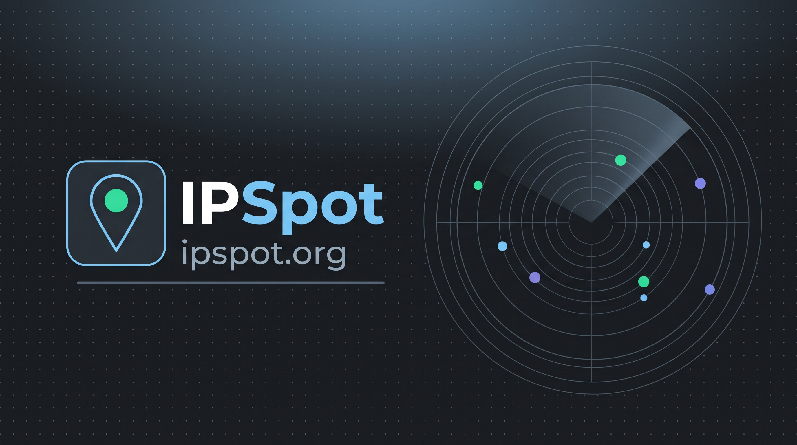

<div align="center">


<h1>IPSpot</h1>

<p>专业、透明、免费的在线 IP 纯净度与网络环境诊断平台</p>

<p><a href="#english">English</a> · <strong>简体中文</strong></p>

<p>
  
  
  
  
</p>

<p><a href="https://ipspot.org">Website</a> · <a href="https://ipspot.org">Live Demo</a> · <a href="#quick-start">Quick Start</a> · <a href="#api">API</a></p>



</div>

<a id="chinese"></a>

## 简体中文

IPSpot 是一个轻量、无数据库依赖的 IP 情报与浏览器网络环境诊断系统，默认以简体中文入口（`/`）与英文子入口（`/en/`）提供双语 SEO 页面，并支持简体中文、繁體中文、English 与日本語实时切换。

### 核心能力

| 模块 | 实现方式与覆盖范围 |
| :--- | :--- |
| **多源位置共识** | 并发聚合 **MaxMind、IP2Location.io、IPInfo.io、ipapi.is、ipwho.is、ipquery.io、ip-api.com、IP.SB、IP.Guide、GeoJS、FreeIPAPI、ipapi.co** 共 12 个地理库，共识校准并支持同屏展开对照。 |
| **原生 / 广播与家宽判定** | 联合 `RDAP`、`RIPEstat` RIR 历史与 ASN/rDNS 关键词，区分原生家宽、双 ISP、企业专线、移动网络与机房节点，直接输入域名时自动经 DoH 解析。 |
| **6 项风险信号交叉核验** | 并行核验 `proxycheck.io`、Tor 官方 `Onionoo`、`StopForumSpam`、`AbuseIPDB`、`Shodan InternetDB` 与多家风控库，展示实际参与核验或命中的源。 |
| **人机流量比与纯净评分** | 接入 `Cloudflare Radar` 近 7 天 ASN 人机请求占比（缺省时按网络模型估算），输出 0–100% 风险系数与逐项扣分明细，不因大网均值误伤纯净家宽。 |
| **交互地图与真实街区反查** | 集成 `Leaflet`（`Esri World_Street_Map`）与滚轮缩放定位；基于坐标通过 `OpenStreetMap Nominatim`、`Photon` 与 `BigDataCloud` 反查同区真实街道、邮编与时区。 |
| **客户端隐私与路由工具** | 内置 `FingerprintJS v4`（Canvas / WebGL / Audio / 字体 / WebDriver 检测）、32 位随机子域 DNS 泄露探测、多 STUN WebRTC 检测、双栈出口测速与 `RIPE RIS Live` BGP 监控。 |
| **多模型容灾 AI 诊断** | 同源后端（`POST /functions/v1/app?action=ai`）按序容灾智谱 GLM、SiliconFlow、Groq、Cloudflare Workers AI，未配置 Key 时自动由内置规则引擎响应。 |

### 项目结构

```text
.
├── web/                        # 前端静态资源（Pages 构建输出目录）
│   ├── index.html              # 默认简体中文入口（canonical: https://ipspot.org/）
│   ├── en/index.html           # 英文入口（canonical: https://ipspot.org/en/）
│   ├── styles.css              # 深浅主题变量、底纹纹理与动效样式
│   ├── app.js                  # 四语言词典、报告渲染、地图与本地探测引擎
│   └── sitemap.xml             # 多语言站点地图
├── functions/functions/v1/
│   └── app.ts                  # Cloudflare Pages Functions 路由 (/functions/v1/app)
├── lib/
│   └── handler.ts              # 共享无状态后端核心（聚合、评分、反查、AI 容灾）
├── deno/
│   └── index.ts                # Deno Deploy 入口
└── dev/
    └── serve.mjs               # 本地预览服务（零构建，Node.js 22+ 原生运行 TS）
```

<a id="quick-start"></a>

### 本地运行

需要 **Node.js 22+**（原生支持运行 `.ts`，低版本可用 `npx tsx dev/serve.mjs`）：

```bash
node dev/serve.mjs
```

启动后访问：`http://127.0.0.1:4173/`（英文入口：`http://127.0.0.1:4173/en/`）。

> **可选本地环境变量（`.env`，勿提交到 Git）**：
> 未配置任何密钥时，基础查询与内置规则引擎 AI 诊断均可直接工作；若需启用特定上游与大模型，可按需添加：
>
> ```env
> CF_RADAR_TOKEN=          # Cloudflare Radar Token（可选，用于 ASN 实测人机比）
> ABUSEIPDB_KEY=           # AbuseIPDB API Key（可选）
> ZHIPU_API_KEY=           # 智谱 GLM-4-Flash（可选，另有 SILICONFLOW / GROQ / AI_API_KEY）
> ```

### 部署方式

**Cloudflare Pages（推荐）**

1. 绑定 GitHub 仓库后，构建预设选择 **`None`**，构建命令留空，输出目录填 **`web`**。
2. 如需零密钥启用内置 AI：在项目 **Settings -> Bindings -> Add** 中添加 **Workers AI**，变量名设为 **`AI`** 后重新部署。
3. 如需附加商业情报源或备用大模型，在 **Environment Variables** 中配置对应 Key 即可。

<a id="api"></a>

### 开放 API

| 接口 | 方法 | 说明 | 示例 |
| :--- | :---: | :--- | :--- |
| 当前访问者报告 | `GET` | 识别请求头 IP 并返回完整报告 | `curl https://ipspot.org/functions/v1/app` |
| 指定 IP / 域名 | `GET` | 查询 IPv4、IPv6 或域名解析目标 | `curl "https://ipspot.org/functions/v1/app?q=openai.com"` |
| ASN / 前缀归属 | `GET` | 查询 ASN 名称及前缀所属国家 | `curl "https://ipspot.org/functions/v1/app?asn=15169&pfx=8.8.8.0/24"` |
| 真实街道反查 | `GET` | 按经纬度反查街道（`jitter=1` 随机附近点） | `curl "https://ipspot.org/functions/v1/app?action=geoaddr&lat=39.0437&lon=-77.4875"` |
| AI 风险诊断 | `POST` | 返回 4 点结构化风控与业务建议 | `curl -X POST "https://ipspot.org/functions/v1/app?action=ai" -H "Content-Type: application/json" -d '{"ip":"1.1.1.1","lang":"zh-CN"}'` |

---

<a id="english"></a>

<div align="center">

<p><strong>English</strong> · <a href="#chinese">简体中文</a></p>

</div>

## English

IPSpot is a lightweight, database-free IP intelligence and browser environment diagnostic platform. It serves Simplified Chinese at root (`/`) and English at `/en/`, with instant UI switching across `zh-CN`, `zh-TW`, `en`, and `ja`.

### Capabilities

| Module | Implementation |
| :--- | :--- |
| **Multi-Source Geo Consensus** | Aggregates up to 12 independent GeoIP feeds (**MaxMind**, **IP2Location.io**, **IPInfo.io**, **ipapi.is**, **ipwho.is**, **ipquery.io**, **ip-api.com**, **IP.SB**, **IP.Guide**, **GeoJS**, **FreeIPAPI**, **ipapi.co**) with consensus coordinate selection. |
| **Origin & Network Classification** | Combines `RDAP`, `RIPEstat` RIR history, and ASN/rDNS patterns to separate native residential, dual-ISP, business, mobile, and datacenter IPs; domains are resolved via DNS-over-HTTPS automatically. |
| **Cross-Verified Risk Signals** | Checks Proxy, VPN, Tor (`Tor Onionoo`), Datacenter, Mobile, and Abuse (`AbuseIPDB`, `StopForumSpam`, `Shodan InternetDB`, `proxycheck.io`) in parallel and lists the actual verified or matched sources. |
| **Human/Bot Ratio & Purity Score** | Integrates 7-day `Cloudflare Radar` ASN traffic data (with model fallback when unconfigured) and calculates a transparent 0–100% risk score with itemized deductions without penalizing clean residential ISPs. |
| **Interactive Map & Street Lookup** | Renders a zoomable `Leaflet` (`Esri World_Street_Map`) view with scroll-wheel zoom and reverse-geocodes nearby street, city, state, country, postal code, and timezone via `OpenStreetMap Nominatim`, `Photon`, and `BigDataCloud`. |
| **Browser & Network Leak Suite** | Runs client-side `FingerprintJS v4`, Canvas/WebGL/Audio/Font hashing, WebDriver/Headless checks, 32-char randomized-subdomain DNS leak probes, multi-STUN WebRTC checks, dual-stack latency tests, and a `RIPE RIS Live` BGP monitor. |
| **Resilient AI Diagnosis** | Same-origin `POST /functions/v1/app?action=ai` endpoint cascades across Zhipu GLM, SiliconFlow, Groq, and Cloudflare Workers AI, falling back cleanly to a deterministic rule engine when no API keys are present. |

### Repository Layout

```text
.
├── web/                        # Static frontend assets (Cloudflare Pages output directory)
│   ├── index.html              # Default zh-CN entry (canonical: https://ipspot.org/)
│   ├── en/index.html           # English entry (canonical: https://ipspot.org/en/)
│   ├── styles.css              # Dark/light themes, canvas textures, and motion system
│   ├── app.js                  # 4-language i18n, UI renderer, map, and browser probes
│   └── sitemap.xml             # Multilingual sitemap
├── functions/functions/v1/
│   └── app.ts                  # Cloudflare Pages Functions handler (/functions/v1/app)
├── lib/
│   └── handler.ts              # Shared stateless backend core
├── deno/
│   └── index.ts                # Deno Deploy entrypoint
└── dev/
    └── serve.mjs               # Zero-build local dev server (Node.js 22+)
```

### Quick Start

Requires **Node.js 22+** (runs `.ts` natively; use `npx tsx dev/serve.mjs` on older Node releases):

```bash
node dev/serve.mjs
```

Open `http://127.0.0.1:4173/` (`http://127.0.0.1:4173/en/` for English).

> **Optional `.env` variables (do not commit)**:
> Core IP intelligence and the built-in rule engine work out of the box with zero keys. Optionally set `CF_RADAR_TOKEN`, `ABUSEIPDB_KEY`, `IPINFO_TOKEN`, `IP2LOCATION_KEY`, `PROXYCHECK_KEY`, or LLM keys (`ZHIPU_API_KEY`, `SILICONFLOW_API_KEY`, `GROQ_API_KEY`, `AI_API_KEY`).

### Cloudflare Pages Deployment

1. Connect the GitHub repository with **Framework preset**: `None`, **Build command**: empty, and **Build output directory**: `web`.
2. To enable free zero-key LLM diagnostics, go to **Settings -> Bindings -> Add -> Workers AI** and bind it as **`AI`**, then redeploy.

### Public API

| Endpoint | Method | Description | Example |
| :--- | :---: | :--- | :--- |
| Caller IP Report | `GET` | Full report for the requester's IP | `curl https://ipspot.org/functions/v1/app` |
| IP / Domain Query | `GET` | Lookup IPv4, IPv6, or domain | `curl "https://ipspot.org/functions/v1/app?q=openai.com"` |
| ASN Ownership | `GET` | ASN name and prefix country | `curl "https://ipspot.org/functions/v1/app?asn=15169&pfx=8.8.8.0/24"` |
| Reverse Street Lookup | `GET` | Real address from coordinates | `curl "https://ipspot.org/functions/v1/app?action=geoaddr&lat=39.0437&lon=-77.4875"` |
| AI Diagnosis | `POST` | 4-bullet risk and usage guidance | `curl -X POST "https://ipspot.org/functions/v1/app?action=ai" -H "Content-Type: application/json" -d '{"ip":"1.1.1.1","lang":"en"}'` |
